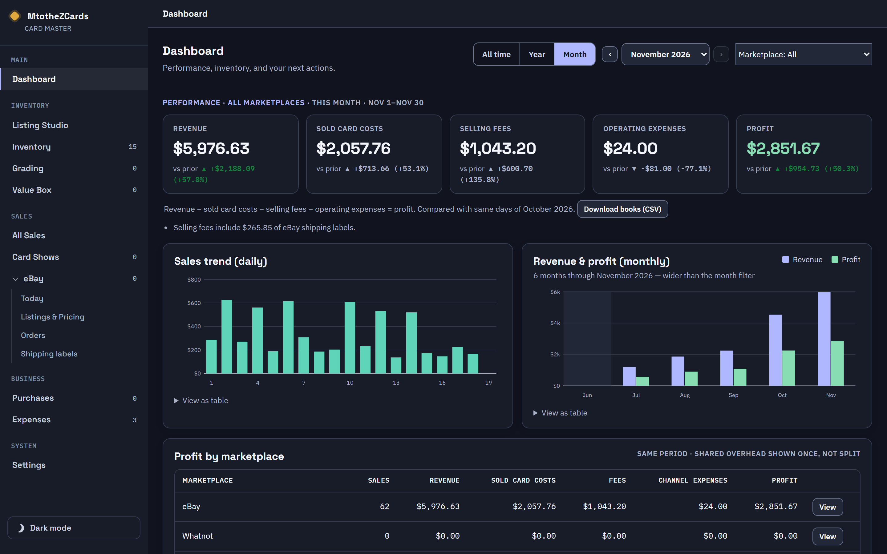
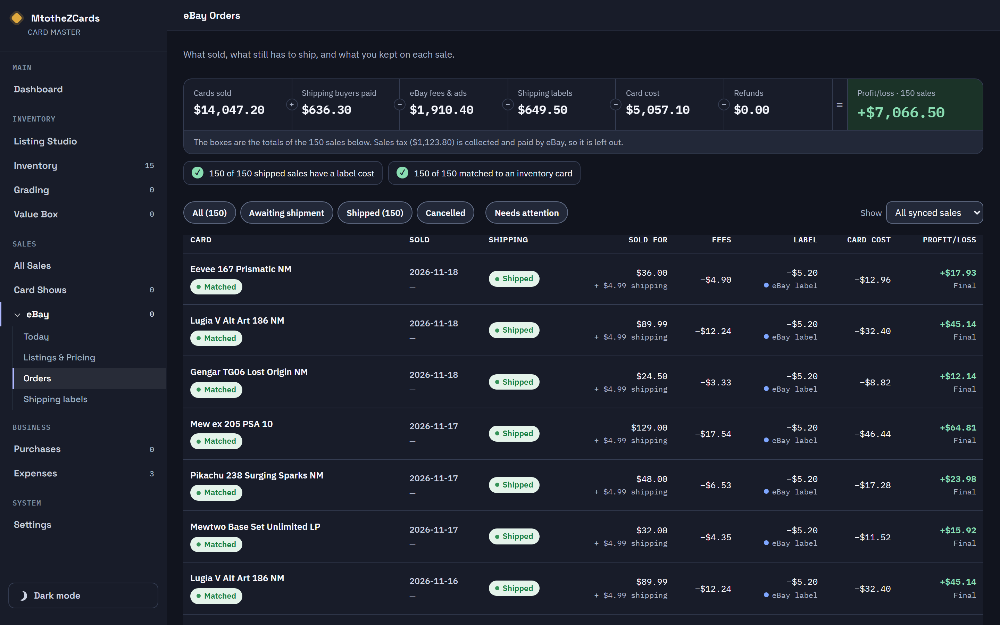
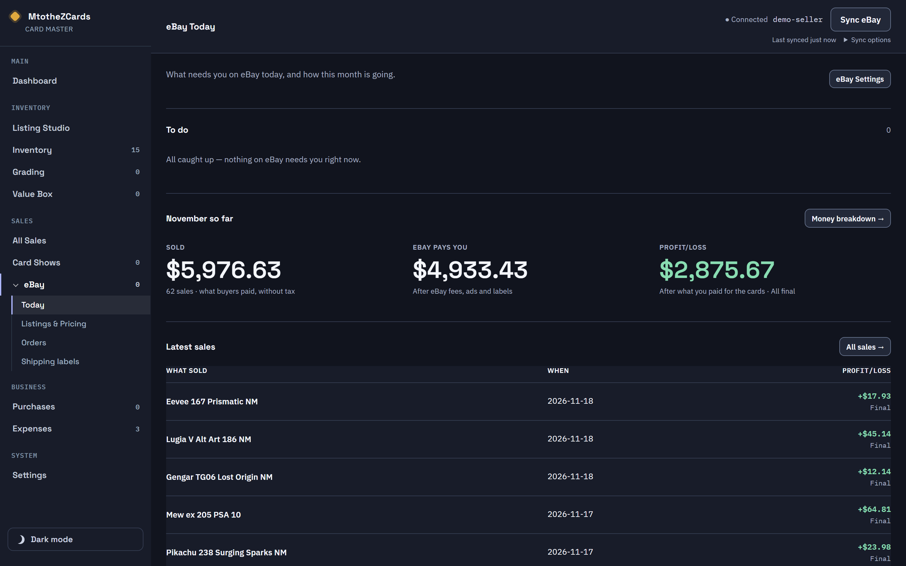
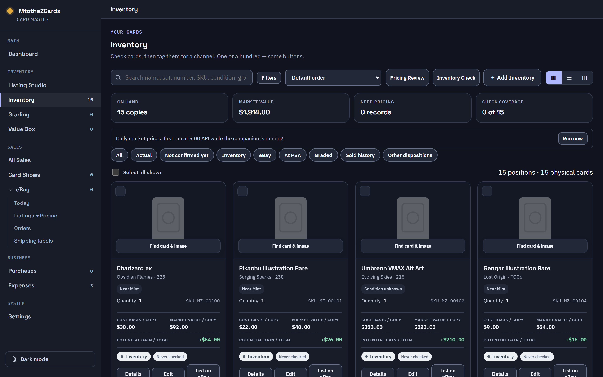

# Card Master

**An operations system for a trading-card resale business, with AI agents that recommend and a human who decides.**

I run MtotheZ Collectibles, a Pokémon card business that sells on eBay, TCGplayer and at card shows (and previously on Whatnot): 2,000+ orders, 800+ positive eBay reviews and about 800 active inventory items. Each platform keeps its own records, so knowing what I owned, what it cost and what I actually earned meant spreadsheets and guesswork.

I designed Card Master to be the business's **system of record**: one place that connects purchases, inventory, listings, sales, fees and profit. It now runs the business on real data every day.

> The source code is private because it runs a live business and holds real customer and order data. This repository explains what the system does and how it is built. I'm happy to walk through it live.

## What it does

| Area | What Card Master handles |
|---|---|
| **Purchases → inventory** | Bulk lots are split into individual cards, and the purchase price is spread across them, so every card has a known cost basis. |
| **Listing** | Select cards, match scan photos to them, review titles and prices, publish to eBay. |
| **Sales and reconciliation** | Reads eBay orders, actual fees, shipping labels, refunds and Best Offers; records Whatnot shows and card-show sales and trades; tracks PSA grading submissions. |
| **Profit** | Cost of goods, fees, expenses and realized profit per card and per channel. |
| **AI agents** | A team of agents handles pricing analytics, Best Offer analysis and buyer messages, and reports to me by phone. Every change waits for my approval. See [AI agents](docs/ai-agents.md). |

## How it's built

- **Browser app** (JavaScript, IndexedDB) for daily work, with full backup and restore
- **Local service** (Python) that holds every API credential (eBay, Shippo, market data) so none reach the browser
- **Hosted development path** on Supabase (PostgreSQL with row-level security), Cloudflare and Render
- **AI agent team** that reads the same local service and talks to me over Telegram
- **240+ automated test suites** (Playwright browser tests and pytest)

Details: [Architecture](docs/architecture.md)

## Rules the system enforces

These are the controls I'm proudest of. They keep the numbers trustworthy:

- A sale counts only when a **verified paid order** exists.
- Money is stored in **whole cents**, and an unknown value **never quietly becomes $0**.
- **Syncing from eBay never creates inventory or changes anything on eBay.** The only writes are publishing and editing listings, price changes, Best Offer responses and buyer message replies, and each one is started or approved by me.
- **Deleting a record reverses what it caused but keeps real sales.**
- **AI recommends; the owner decides.** No agent can change a price, answer an offer or message a buyer on its own.
- Each significant decision is written down as a **decision record** (21 so far).

Details: [Controls and data rules](docs/controls-and-data-rules.md) · [Example decision record](docs/decision-record-example.md)

## How I built it

I wrote the product requirements, data rules and decision records, and used AI coding agents to implement them, checking every change against the automated test suites. My role was the one a business systems analyst plays: define the problem, set the rules, decide the trade-offs, and verify the result.

## By the numbers

| | |
|---|---|
| Application code | ~60,000 lines of JavaScript, ~19,000 lines of Python |
| Automated test suites | 240+ |
| Decision records | 21 |
| Channels reconciled | eBay, card shows, direct sales and Whatnot (past channel), plus PSA grading |
| In daily use | Yes, on real business data |

## Screenshots

*Shown with demo data, not real customers or orders.*

**Dashboard:** revenue, card costs, fees, expenses and profit for the month, with trends and profit by marketplace.

**eBay orders:** every sale with its actual fees, shipping label and card cost, and a check that each sale is matched to an inventory card.

**eBay today:** what needs attention and how the month is going.

**Inventory:** each card with its cost basis, market value and potential gain.

## About me

Fernando Munoz Corona · Information Systems, University of Nevada, Las Vegas (graduating Fall 2027) · Las Vegas, NV
[LinkedIn](https://www.linkedin.com/in/fernando-munoz-corona-96928022a/)
