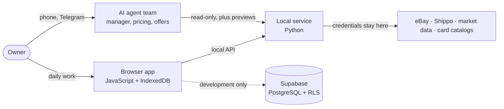

# Architecture

Card Master runs on my own computer first. The cloud is used only for development and will take over only after the local setup runs the whole business reliably.

## Parts

| Part | Role |
|---|---|
| **Browser app** | Inventory, purchases, listing, sales, expenses and profit. All business records live in the browser's database, with a one-file full backup that restores the whole business. No build step: plain JavaScript files loaded in a fixed order. |
| **Local service** | A Python service on the same computer. It serves the app and is the only thing that talks to outside services. Every API credential lives here and never reaches the browser or a backup. |
| **AI agent team** | Agents that read inventory, listings, orders, offers and market prices through the local service, and report recommendations to me by phone. See [AI agents](ai-agents.md). |
| **Development cloud** | Supabase (PostgreSQL with row-level security), Cloudflare and Render. Used for identity, inventory ID allocation and scan images. Tested so one workspace can never read another's data. |

## Single paths

Each important action has exactly one place in the code that can do it, so it can be tested and trusted:

- One place creates a new inventory ID, and an ID is never reused.
- One place turns a marketplace order into a sale and calculates its fees and profit.
- One path writes to eBay, and it requires my consent.
- One path holds credentials.

## Testing

- 191 browser regression suites (Playwright) covering inventory, purchases, listing, orders, offers, profit and backup.
- 54 Python test files for the local service and the hosted API.
- Automated tests are blocked from reaching live eBay and can never grant publishing consent.
